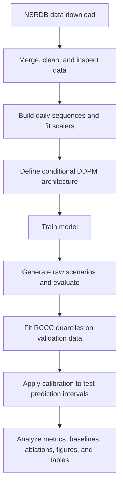

# GenerativeAURORA

**Conditional diffusion-based scenario generation for Global Horizontal Irradiance (GHI), with regime-conditioned conformal calibration.**

GenerativeAURORA is a research codebase for generating ensembles of plausible 16-hour GHI trajectories conditioned on weather/solar context, sky regime, and study-site identity. A conditional Denoising Diffusion Probabilistic Model (DDPM) generates raw scenarios; Regime-Conditioned Conformal Calibration (RCCC) is then used to calibrate prediction intervals separately by sky regime.

> **Research status:** This repository contains research scripts for data preparation, model training, scenario generation, conformal calibration, evaluation, figures, tables, and baseline comparisons. Results should be interpreted in light of the actual experiment configuration, data split, and implementation details documented below.

**Overview**
Solar generation is uncertain and affected by weather conditions, cloud regimes, and location-specific patterns. Rather than returning only one GHI estimate, GenerativeAURORA generates multiple scenarios to represent a conditional distribution of plausible GHI trajectories. The scenarios can be summarized as prediction intervals and evaluated using probabilistic accuracy and interval-calibration metrics.

The implemented model is conditioned on:
- Weather/solar context: a 16-timestep sequence with 10 input features.
- Sky regime: Clear, Cloudy, or Overcast.
- Site identity: one of five study locations.
- Diffusion timestep: indicates the noise level used in the denoising process.
The principal outputs are raw GHI scenarios, raw and calibrated prediction intervals, evaluation metrics, and paper-oriented figures and tables.

**Workflow**
The main end-to-end pipeline follows this order:

**Main script sequence**
Run the core scripts in the following order. Script names may be case-sensitive on Linux and in GitHub environments, so use the exact filenames present in your checkout.
| Stage | Script | Purpose |
|---|---|---|
| 1 | `download_nsrdb.py` | Downloads hourly NSRDB data for the configured study sites and years. |
| 2 | `merge_nsrdb.py` | Merges and cleans downloaded files, standardizes columns, and prepares the merged dataset. |
| 3 | `eda_nsrdb.py` | Summarizes and inspects the merged data. |
| 4 | `step3_build_sequences.ipynb` | Fits feature-scaling parameters, builds fixed-length daily sequences, encodes regime/site labels, and creates train/validation/test splits. |
| 5 | `step4_build_model.ipynb` | Defines the conditional DDPM architecture. Running this script directly also performs shape checks; it does not train the model. |
| 6 | `step5_train.ipynb` | Trains the model and saves checkpoints, including the best validation checkpoint. |
| 7 | `step6_evaluate.ipynb` | Generates raw scenarios for the test set and calculates overall, per-regime, and per-site metrics. |
| 8 | `step7_conformal.ipynb` | Estimates regime-conditioned calibration quantiles from validation scenarios, applies them to test intervals, and reports before/after interval metrics. |
| 9 | Step 8–12 analysis scripts | Generate figures, ablation outputs, baseline comparisons, and final results tables. These are supplementary analysis stages; run the specific scripts needed for your paper outputs. |

**Data and preprocessing**
Data source and study locations
The project uses hourly solar and meteorological data from the **National Solar Radiation Database (NSRDB)**. The configured study period is 2018–2022, and the model configuration uses five US sites:
1. Phoenix, Arizona
2. Los Angeles, California
3. Denver, Colorado
4. Miami, Florida
5. Seattle, Washington
The downloader's actual site list and downloaded files should be checked before processing. Some draft workflow diagrams or earlier notes may refer to a different number of sites; the model configuration in `step4_build_model.py` is set to five sites.

NSRDB information: https://nsrdb.nrel.gov/

**Input features**
The sequence builder configures these 10 conditioning features:
- GHI
- DHI
- DNI
- WIND SPEED
- TEMPERATURE
- RELATIVE HUMIDITY
- PRESSURE
- CLEARSKY GHI
- SOLAR ZENITH ANGLE
- CLEARNESS_INDEX
The target sequence is GHI. Names in source files must match the names expected by the preprocessing scripts; where the script explicitly harmonizes column names, those mappings are applied before sequence construction.

**Clearness index and sky regimes**
The project derives the clearness index from GHI and clear-sky GHI, with values clipped to the range `[0, 1]`:
[
\text{Clearness Index} = \frac{\text{GHI}}{\text{Clear-sky GHI}}
]
The regime thresholds implemented in the data-preparation scripts are:
| Clearness index | Sky regime | Encoded label |
|---|---|---:|
| `<= 0.10` | Overcast | 2 |
| `> 0.10` and `<= 0.35` | Cloudy | 1 |
| `> 0.35` | Clear | 0 |

For each valid day and site, the sequence builder sorts observations by hour, requires a minimum number of daytime observations, creates fixed-length arrays, and stores the dominant daily sky regime and site ID.

**Sequence dimensions and split**
| Item | Configuration |
|---|---|
| Weather/solar context (`X`) | `(N, 16, 10)` |
| Target GHI (`Y`) | `(N, 16)` |
| Sky regime | One label per sequence |
| Site | One ID per sequence, from 0 to 4 |
| Lookback | 16 timesteps |
| GHI horizon | 16 timesteps |

The current sequence-building implementation uses a temporal split:
| Split | Period |
|---|---|
| Training | 2018–2021 |
| Validation | January–June 2022 |
| Test | July–December 2022 |

Min-max scaling parameters are fitted on training-year observations and saved for reuse. Validation and test data should not be used to fit the scaling parameters.

**Model architecture**
`step4_build_model.py` defines a conditional DDPM. It contains several components with different roles; they are not interchangeable model names.
1. Condition encoder — 1D CNN + two-layer GRU. Two 1D convolutional layers extract local patterns from the 16 × 10 weather context. A two-layer GRU then encodes temporal dependencies into a 64-dimensional context vector.
2. Regime and site embeddings. Learned 64-dimensional embeddings encode the three sky regimes and five site IDs.
3. Timestep embedding. A sinusoidal representation of the diffusion timestep is passed through a small MLP (`64 → 128 → 64`).
4. Condition fusion MLP. The timestep, regime, site, and weather-context vectors are concatenated (`4 × 64 = 256`) and projected using `256 → 128 → 64`, with SiLU activation between the linear layers.
5. 1D diffusion U-Net. A residual encoder–bottleneck–decoder network processes the noisy GHI trajectory. Timestep and condition information are injected into its residual blocks, and skip connections pass encoder features to the decoder.
6. Diffusion process. The implemented linear beta schedule uses 200 diffusion steps, with beta values from `1e-4` to `0.02`. Training learns to predict added noise; inference iteratively denoises random noise into GHI trajectories.

**Model summary**
| Setting | Value |
|---|---:|
| Lookback length | 16 |
| GHI trajectory length | 16 |
| Conditioning features | 10 |
| Embedding dimension | 64 |
| U-Net base hidden dimension | 128 |
| Diffusion steps | 200 |
| Scenarios per sample in the main evaluation configuration | 50 |

A two-layer GRU in the condition encoder is not the same as the two-layer MLP used for conditioning fusion. The implementation includes both, plus the separate MLP inside the timestep-embedding module.

**Training, scenario generation, and calibration**
**Training**
`step5_train.py` loads the sequences prepared by Step 3 and trains the model defined in Step 4. It uses a noise-prediction objective and saves model checkpoints, including the best validation checkpoint. Training parameters should be read from the current script configuration rather than inferred from plots or manually maintained paper notes.
**Scenario generation and evaluation**
`step6_evaluate.py` loads the trained model and generates an ensemble of 50 scenarios per test sequence in the main configuration. It calculates metrics overall and stratified by sky regime and site.
Metrics used in the project include:
- CRPS: evaluates probabilistic forecast quality; lower is better.
- Pinball loss: evaluates quantile predictions; lower is better.
- Median-scenario MAE: measures absolute error against the median generated scenario; lower is better.
- Prediction-interval coverage: the empirical proportion of observations inside an interval. For a nominal 90% interval, the target is approximately 90% coverage.
- Prediction-interval width: the average width of the interval; narrower is preferable when coverage is adequate.

**Regime-Conditioned Conformal Calibration (RCCC)**
`step7_conformal.py` estimates nonconformity scores and calibration quantiles from the validation split separately for Clear, Cloudy, and Overcast samples. The calibration quantile is then used to adjust the raw test prediction-interval bounds. The script reports interval coverage and width before and after RCCC, overall and by regime/site.
A key implementation distinction is preserved in the evaluation:
- CRPS, pinball loss, and median MAE are calculated from the raw generated scenarios.
- Coverage and interval width are calculated from prediction intervals, with before/after RCCC comparisons.
RCCC changes the prediction intervals; it does not need to rewrite the raw scenario ensemble to do so.

**Output**
Exact output paths depend on the path constants in each script, but the pipeline commonly creates files such as:
1. `nsrdb_merged.parquet` — merged dataset.
2. `sequences_train.npz`, `sequences_val.npz`, `sequences_test.npz` — sequence datasets.
3. `scaler_params.json` — fitted min/max parameters.
4. `sequence_summary.json` — sequence summary.
5. `best_model.pt` and checkpoint/log files — trained model artifacts.
6. `test_scenarios.npz` — raw test scenarios and associated labels/actuals (from evaluation scripts).
7. `rccc_calibration.json` — regime-conditioned calibration quantiles.
8. `calibrated_intervals.npz` and `rccc_results.csv` — calibrated intervals and before/after interval metrics, depending on the script version.
9. Figure files under the configured figures directory.
10. CSV/JSON files containing comparison metrics and paper tables.
The evaluation and paper-analysis scripts have evolved across iterations. Check the output filenames in the exact version you run before relying on a downstream script to find a particular artifact.

**Installation and setup**
A Python environment with PyTorch, NumPy, pandas, Matplotlib, and PyArrow is needed for the main modeling/data pipeline. The downloader may also require `requests`. Additional scripts can have their own dependencies.
Example setup:
python -m venv .venv
Activate the environment, then install the core dependencies:
python -m pip install --upgrade pip
python -m pip install torch numpy pandas matplotlib pyarrow requests
For GPU training, install a PyTorch build compatible with the CUDA environment on your machine. Check the official PyTorch installation selector if needed: https://pytorch.org/get-started/locally/.

**Running the project**
1. Configure the data downloader's study sites, years, required variables, and credentials.
2. Run `download_nsrdb.py` and verify that the expected site-year files were downloaded successfully.
3. Run `merge_nsrdb.py`, then `eda_nsrdb.py` to inspect the merged data.
4. Run `step3_build_sequences.py` to create train/validation/test sequence files and scaler parameters.
5. Run `step4_build_model.py` to check the model definition and tensor shapes. This step defines the architecture; it does not perform training.
6. Run `step5_train.py` to train the model and save checkpoints.
7. Run `step6_evaluate.py` to generate raw scenarios and metrics.
8. Run `step7_conformal.py` to compute validation calibration quantiles and evaluate calibrated test intervals.
9. Run the required Step 8–12 figure, ablation, baseline, and table scripts to produce the paper outputs.
For expensive training and sampling runs, use a suitable GPU when available. Validate that all intermediate files were generated before proceeding to the next stage.

